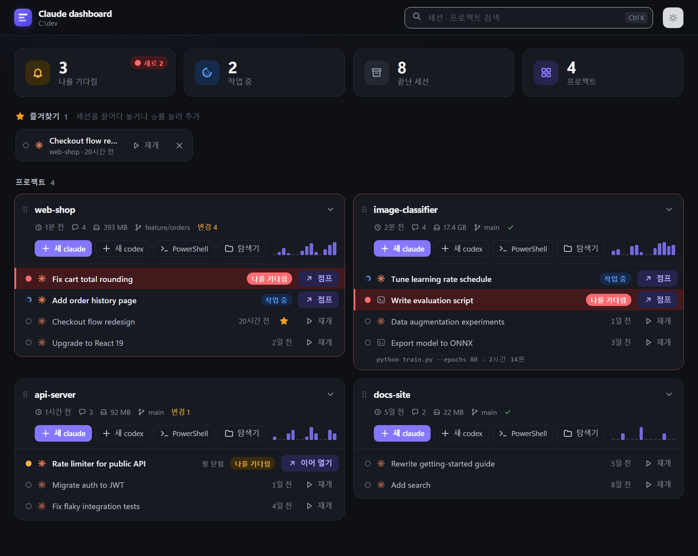

# Claude dashboard

[한국어](README.md) | **English**

A desktop app that shows every [Claude Code](https://claude.com/claude-code) session you are running across your projects on one screen. It shows [Codex](https://developers.openai.com/codex/cli) sessions too.
You can see at a glance which sessions are **working** and which are **waiting for you**, and jump to the right terminal tab with one button.



*Project and session names in the picture are sample data.*

- Runs on Windows and macOS.
- It only **observes** sessions. It never ends a process and never changes Claude Code's settings or your conversations.
- No server and no account. It runs entirely on your machine and sends nothing out.

> **The app's interface is in Korean only for now.** This page gives the Korean label next to each button name so you can find your way around.

## What it does

| Feature | Description |
|---|---|
| Session status | Lists sessions per project as **working** (작업 중), **waiting for you** (나를 기다림) or **ended** (끝남). Waiting sessions get a red dot |
| **Jump** (점프) | Brings the terminal window and tab of that session to the front |
| **Resume** (재개) | Reopens an ended session in a new tab (`claude --resume` for Claude, `codex resume` for Codex) |
| **New claude** (새 claude) · **New codex** (새 codex) | Starts a new session in that project folder. **New codex** appears only on machines that use Codex |
| **PowerShell** (**Terminal** on macOS) · **Explorer** (**Finder** on macOS) | Opens a shell or a folder window in that project folder |
| **Trash** (휴지통) | Moves an ended session's transcript to the recycle bin (recoverable) |
| Search | `Ctrl+K` or `/` finds sessions by session name or project name |
| Favorites | Click the ☆ on a session row, or drag the row into the favorites area |
| Project overview | Last activity, folder size, git branch and number of uncommitted changes, activity over the last 14 days |
| Job monitor | Shows programs that have been running in a project folder for more than a minute (training runs, builds and so on) |

You can drag project cards to reorder them, double-click a name to give it a display name, and collapse cards. There is a light theme and a dark theme.

## Install

You need:

- **Claude Code** (the `claude` command must run in your terminal)
- **Python 3.10 or later**
- **git**
- On Windows, **Windows Terminal** is recommended (it ships with Windows 11)

The dashboard works from **one projects folder** (for example `C:\dev` or `~/dev`) and treats each folder directly under it as a project. The installer asks for this folder.

### Windows

In PowerShell:

```powershell
git clone https://github.com/rhee-hakseung/claude-dashboard.git C:\dev\claude-dashboard
C:\dev\claude-dashboard\install.cmd
```

The installer puts a **Claude dashboard** icon on your desktop. Double-click it to open the app.
If Python is missing, the installer offers to install it with `winget`.

### macOS

In a terminal:

```bash
git clone https://github.com/rhee-hakseung/claude-dashboard.git ~/dev/claude-dashboard
cd ~/dev/claude-dashboard && ./install.sh
```

The installer asks for the projects folder and the terminal app (Terminal, iTerm2 or Ghostty). If you run it from Ghostty or iTerm2, that app is offered as the default.
It creates `~/Applications/Claude dashboard.app`. Open it from Spotlight or drag it to the Dock.
If Python is missing, install it first with `brew install python@3.13`.

> **macOS support has not been verified on a real Mac yet.** It was written on Windows, and only the tests and the install script were checked on Linux.
> The first time you use it, try [Jump] and [New claude] once each, and please open an issue if something does not work.

### Updating and uninstalling

- **Update**: run `git pull` in the cloned folder, then run the installer again. Running it again is safe.
- **Change the projects folder**: run the installer again and enter the new folder.
- **Change the terminal app** (macOS): run the installer again and enter Terminal, iTerm2 or Ghostty. You can also pass both at once, as in `./install.sh ~/dev Ghostty`.
- **Uninstall**: delete the cloned folder and the desktop icon (the app on macOS). The settings file lives separately, at the location below.

Settings (window position, display names, order, favorites, theme) are stored outside the cloned folder, so they survive updates.

| | Settings location |
|---|---|
| Windows | `%LOCALAPPDATA%\dev-dashboard\state.json` |
| macOS | `~/Library/Application Support/dev-dashboard/state.json` |

## Codex sessions

If a `~/.codex` folder exists, Codex sessions appear in the same list with a **Codex** mark. This covers sessions started with `codex` in a terminal.

| | Claude Code | Codex |
|---|---|---|
| How live sessions are found | The session list files Claude Code writes | Running `codex` processes |
| Working / waiting for you | Status in the session list, plus the transcript | The last turn-started or turn-completed marker in the transcript |
| Resume | `claude --resume <id>` | `codex resume <id>` |
| Trash | Moves the transcript file to the recycle bin | Not supported. Clean up in Codex with `codex archive` |

- While Codex is **waiting for you to approve** a command, it shows as "working". The transcript alone cannot tell the two apart.
- A session you just started and have not typed into yet shows as "새 Codex 세션" (new Codex session).
- [Jump] selects the tab when the tab title is the folder name. If the title is different, it only brings the window to the front.
- Conversations inside the Codex desktop app appear only in the ended list, and only those held inside your projects folder.

## Differences between Windows and macOS

| | Windows | macOS |
|---|---|---|
| Where new tabs open | A new tab in the open Windows Terminal window, or a new window if none is open | The terminal app chosen at install time (Terminal, iTerm2 or Ghostty). Terminal and iTerm2 open a new window; Ghostty opens a new tab in the open window (Ghostty 1.4 or later) |
| Terminals [Jump] works with | Windows Terminal, PowerShell console windows | Terminal, iTerm2, Ghostty |
| Permission asked once | None | "Allow control of Terminal" (or the terminal app you chose), under System Settings › Privacy & Security › Automation |

## Good to know

- **Sessions with [Jump] disabled**: the dashboard could not find their window, as with sessions in the VS Code integrated terminal or inside tmux. Their status is still shown.
- **"창 닫힘" (window closed) + [이어 열기] (continue)**: the terminal window or tab was closed but the session process is still alive. The button reopens the same conversation in a new tab.
- **Several tabs with the same title**: [Jump] brings the window to the front without selecting a tab, so that it never selects the wrong one.
- **A `?` next to a session row**: the two sources of status information disagree. It is not an error.
- **An ended session disappeared from the list**: Claude Code cleaned up the old transcript itself (30 days by default). The dashboard moves only the transcripts you press [Trash] on.
- **Sessions started in a subfolder of a project** appear on that project's card.
- Clicking the icon twice opens two windows. If the app is already open, find it on the taskbar.

## What it touches and what it does not

- **It never ends a process.** Closing the dashboard does not affect your sessions.
- **It only reads `~/.codex`.** It never moves or deletes Codex transcripts.
- **It only reads `~/.claude`.** The one exception is moving a single transcript file to the recycle bin when you press [Trash]. Transcripts of live sessions are never moved.
- **It does not send your conversations anywhere or store them elsewhere.** The screen shows only session titles, status and times. An ended session that has no title yet shows the beginning of its first message in place of a title.
- **It neither reads nor writes Claude Code's settings file.**
- The only files it writes are the `state.json` above and a cache in the same folder.

## Development

```bash
# Windows
.venv\Scripts\python.exe -m pip install pytest
.venv\Scripts\python.exe -m pytest tests -q

# macOS / Linux
.venv/bin/python -m pip install pytest && .venv/bin/python -m pytest tests -q
```

- Python code is in `dashboard/`; the interface is HTML/CSS/JS in `web/`. The interface runs in a `pywebview` window, and Python does the collecting and the button actions.
- The entry point is `app.py` at the top level (the icon made by the installer runs this file).
- Internal notes, such as what each file does, the status rules and how [Jump] works, are in [docs/INTERNALS.md](docs/INTERNALS.md) (in Korean).
- To hand the app over without GitHub, run `build-zip.ps1` on Windows to build a zip in `dist\`. The recipient unpacks it and runs `install.cmd`.

## License

[MIT](LICENSE)
